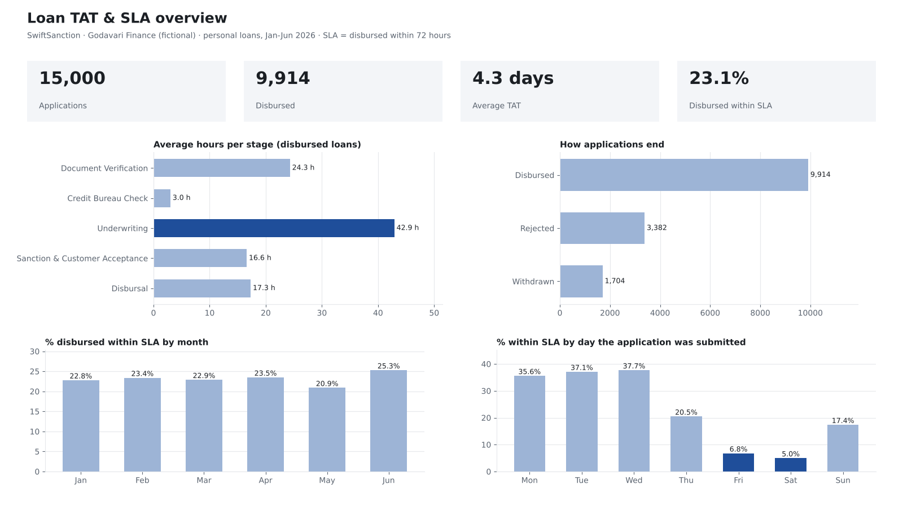
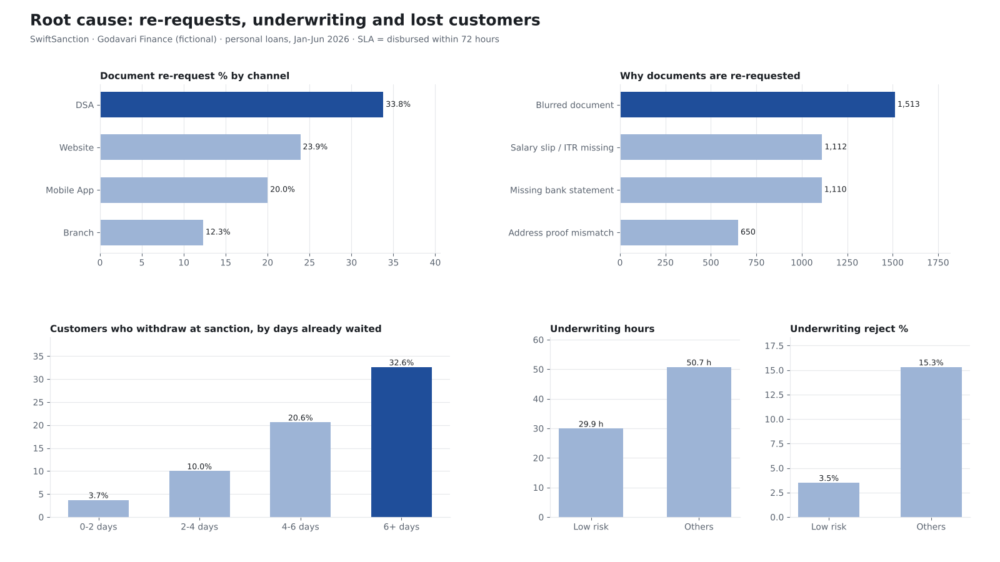

# 04_powerbi

Two-page dashboard design for the lending operations head.

| Page | Question it answers | Visuals |
| --- | --- | --- |
| 1. TAT & SLA overview | How fast are we, and where does the time go? | 4 KPI cards (applications, disbursed, avg TAT, % within SLA), avg hours per stage, how applications end, SLA % by month, SLA % by submission day; slicers for channel, employment type, city tier |
| 2. Root cause | Why is it slow, and what does it cost us? | Re-request % by channel, re-request reasons, withdrawal % by days waited, underwriting hours and reject % for low-risk vs other applications |

- [`DAX_measures.md`](DAX_measures.md): load steps, Power Query step, relationships, calculated columns, measures and expected values
- [`screenshots/`](screenshots): preview of both pages

> The previews are drawn from the same data and match the Excel and SQL results. The `.pbix` file will be added to this folder once it is built in Power BI Desktop using the steps above.
