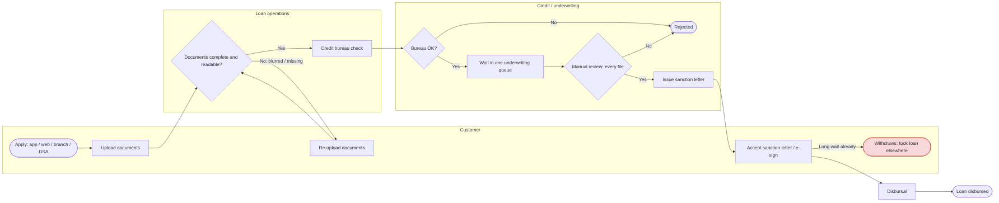
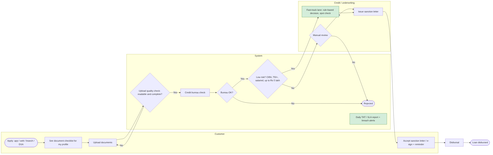

# 3. Process flows (AS-IS and TO-BE)

Swimlane flows drawn in Mermaid (sources: [`as_is.mmd`](as_is.mmd), [`to_be.mmd`](to_be.mmd)).

## AS-IS

Pain points (from the data):
1. **Documents bounce back:** 21.5% of applications need a re-upload; blurred documents are the top reason (34.5% of re-requests). Each re-request adds about 47 hours.
2. **One queue for every file:** every application waits in the same underwriting queue for a full manual review, including low-risk files that are rejected only 3.5% of the time.
3. **No weekend cover:** files submitted on Friday or Saturday wait through Sunday; only 5.0-6.8% of them meet the SLA.
4. **No early warning:** nobody sees a file breaching the SLA until the customer complains or withdraws.

## TO-BE

What changes (green boxes):
1. The customer sees a **document checklist for their profile** (salaried / self-employed) and an **upload quality check** rejects blurred or incomplete files at upload, not two days later.
2. **Low-risk applications** (CIBIL 750+, salaried, loan up to Rs 5 lakh) go to a **fast-track lane**: a rule-based decision with a credit officer spot check.
3. A **daily TAT / SLA report** with breach alerts shows the ops manager which files are stuck and where.
