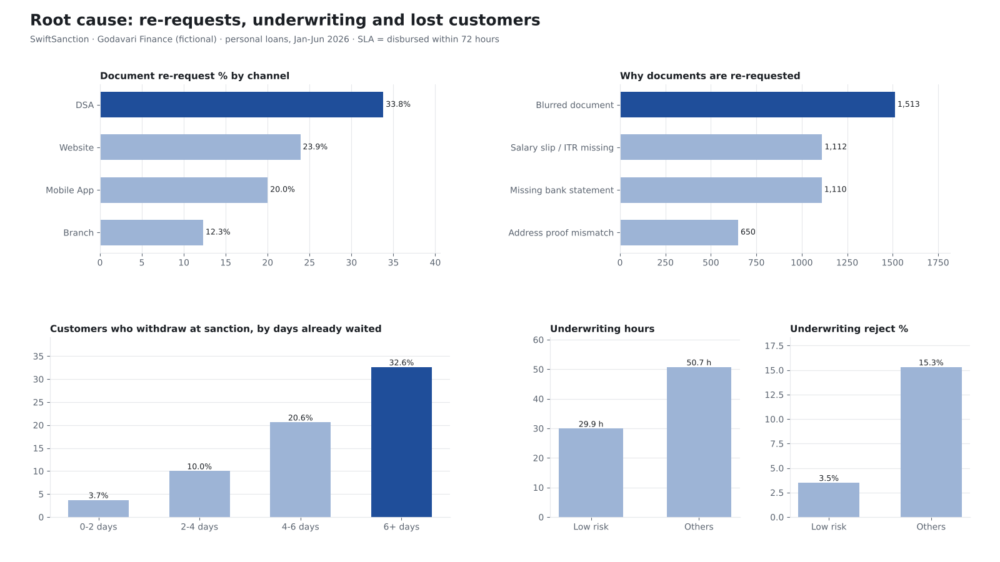

# SwiftSanction: Personal Loan TAT Reduction · BA Case Study

> Business Analysis case study on **synthetic data**. Godavari Finance is a fictional lender.

## Business problem

Godavari Finance promises to disburse a personal loan within **72 hours** of the application. Most loans miss that promise, and customers who wait too long take a loan elsewhere. As a Business Analyst, the goal was to find **where the time goes**, **why**, and define requirement-backed changes that make loans faster without loosening credit checks.

## Key findings (15,000 applications, Jan-Jun 2026)

1. Only **23.1%** of 9,914 disbursed loans met the 72-hour SLA; average TAT was **4.3 days**.
2. **Underwriting** is the slowest stage: **42.9 hours**, **41%** of TAT. Low-risk files (CIBIL 750+, salaried, up to Rs 5 lakh) still wait **29.9 hours** for a manual review, though only **3.5%** of them are rejected.
3. **21.5%** of applications needed a document re-upload (DSA **33.8%**, Branch **12.3%**). Each re-request adds about **47 hours**. Top reason: **blurred documents** (34.5%).
4. Slow loans lose customers: withdrawal at sanction rises from **3.7%** (waited under 2 days) to **32.6%** (waited 6+ days). **1,269** customers walked away at sanction.
5. Applications submitted on **Friday / Saturday** meet the SLA only **6.8% / 5.0%** of the time (Mon-Wed: 35.6-37.7%), because ops is closed on Sunday.

## Proposed solution

| Priority | Solution |
| --- | --- |
| Must | Document checklist by employment type · upload quality check · fast-track underwriting lane for low-risk files (with spot checks) · daily TAT / SLA report and breach alerts |
| Should | DSA re-request scorecard · e-sign reminders and loan status tracker |
| Could | Sunday document verification cover |

**Expected impact** (fast-track + half of re-requests avoided only): about **179 fewer withdrawals** per 6 months (about **Rs 6.4 crore** more disbursed), average TAT **4.3 → about 3.8 days**, SLA **23.1% → about 36%** ([estimate and assumptions](05_ba_docs/10_ROI_estimate.md)).

## What's in this repo

| Folder | Contents |
| --- | --- |
| [`01_data`](01_data) | Raw data (with deliberate quality issues), cleaned data, stage events, data dictionary |
| [`02_excel`](02_excel) | Excel workbook: cleaning log, formula columns, KPIs and analysis tables, all formula-driven |
| [`03_sql`](03_sql) | PostgreSQL schema, load script, 12 business queries and their results |
| [`04_powerbi`](04_powerbi) | 2-page dashboard design, Power Query step, DAX measures and page previews |
| [`05_ba_docs`](05_ba_docs) | Problem statement, RACI, AS-IS / TO-BE flows, 5 Whys, fishbone, gap analysis, MoSCoW, **BRD**, user stories, RTM, UAT cases, impact estimate |
| [`scripts`](scripts) | Data generator, impact estimate, dashboard preview |
| [`BUILD_GUIDE.md`](BUILD_GUIDE.md) | Step-by-step build of the Excel, SQL and Power BI parts |

## Approach

1. **Discover:** problem statement, SMART goals, stakeholders and RACI
2. **Clean:** removed 250 duplicates, fixed 555 channel values, converted 400 text amounts, filled 200 blank employment types in Excel
3. **Analyse:** TAT, SLA and re-request analysis in Excel; stage timing and withdrawal analysis in SQL; Excel and SQL results match
4. **Visualise:** 2-page dashboard (TAT & SLA overview, root cause)
5. **Define:** AS-IS / TO-BE flows, 5 Whys, fishbone, gap analysis, MoSCoW
6. **Document:** BRD, 10 user stories with acceptance criteria, RTM, 13 UAT test cases
7. **Measure:** impact estimate and success KPIs

## Tools

Excel · PostgreSQL · Power BI (Power Query, DAX) · Mermaid (process flows)

## Author

Salil Gokhale · [LinkedIn](https://www.linkedin.com/in/salil-gokhale-analytics) · [GitHub](https://github.com/Salil360-cyber)
